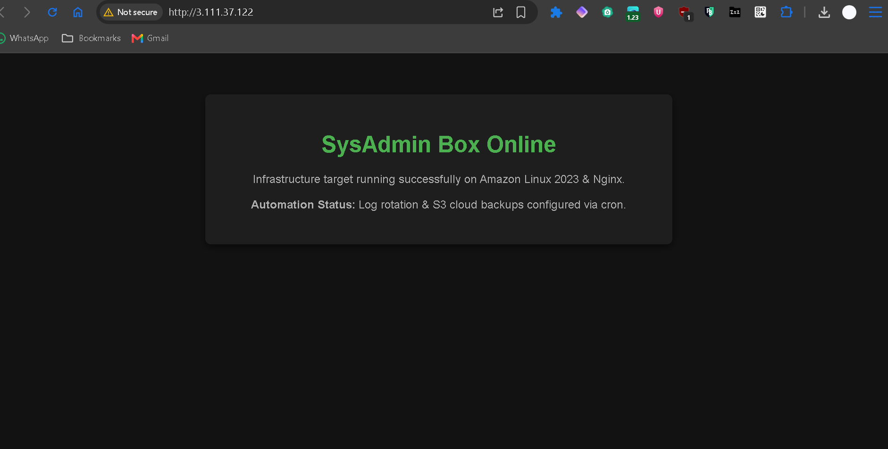
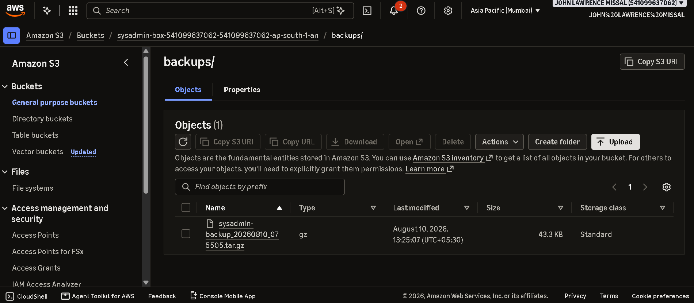

# Project 1 — SysAdmin Box

Automated Linux Server on AWS with Nginx, Log Cleanup, and S3 Backups.

This is my first hands-on DevOps project. The goal was to set up a real server, host a website on it, and automate the maintenance work that is usually forgotten — log cleanup and backups.




Website running live on Nginx.



S3 backup folder with .gz log file.

## Overview

- **Server:** AWS EC2, Amazon Linux 2023
- **Web Server:** Nginx, hosting a status page
- **Log Cleanup:** Bash script (`scripts/log-cleanup.sh`)
- **Cloud Backup:** Python script (`scripts/s3-backup.py`) using boto3
- **Automation:** Cron, runs daily at 2 AM
- **Security:** IAM Role for EC2 to S3 access, no credentials stored in code

## How It Works

1. A user visits the website, Nginx serves the page and generates logs.
2. Every night at 2 AM, `log-cleanup.sh` finds Nginx logs older than 7 days, compresses them to `.gz`, and moves them to `/var/log/nginx/old_logs`. Archives older than 30 days are deleted.
3. `s3-backup.py` then uploads only the `.gz` files from that folder to the S3 bucket, under `backups/`.
4. The server stays clean, and the logs remain safely stored in S3.

## Project Structure

```
sysadmin-box/
├── screenshots/
│   ├── website.png
│   └── s3.png
├── scripts/
│   ├── log-cleanup.sh
│   └── s3-backup.py
└── README.md
```

## Cron Setup

```bash
0 2 * * * /home/ec2-user/sysadmin-box/scripts/log-cleanup.sh
```

Check with: `crontab -l`

## IAM Setup

```
IAM Role: sysadmin-box-ec2-s3-role
Attached to: EC2 instance
Permission: Allow EC2 to upload to S3 only
Note: No AWS keys stored in code
```

## What I Learned

- Managing a remote Linux server through SSH and EC2 Instance Connect
- Installing and configuring Nginx
- Writing Bash scripts for system maintenance
- Scheduling jobs with Cron
- Automating AWS tasks with Python and boto3
- Securing EC2 to S3 access using IAM Roles
- Using Git and GitHub for version control

## Notes

Most of the learning in this project came from debugging — file permissions, script paths, and IAM permissions. Fixing those issues made the concepts much clearer than just following a tutorial.

---
Status: Completed
