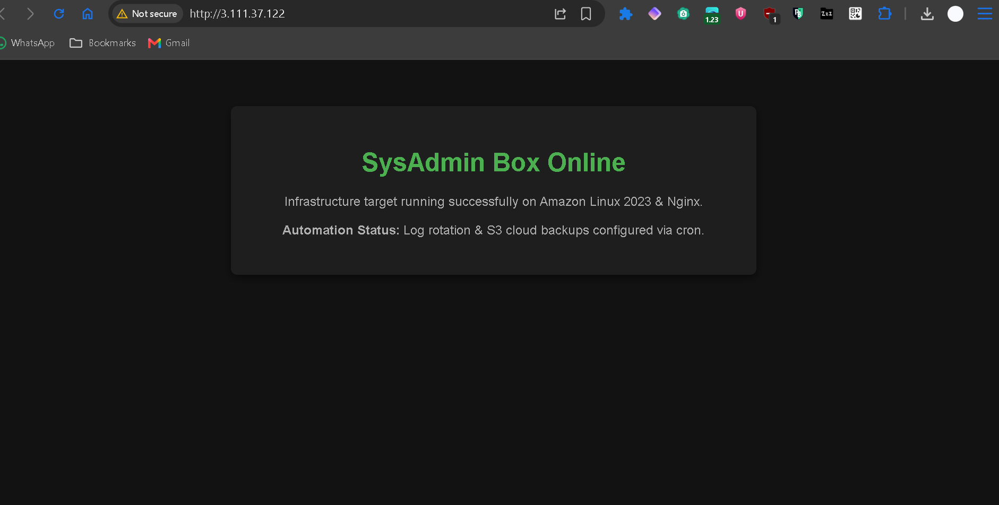
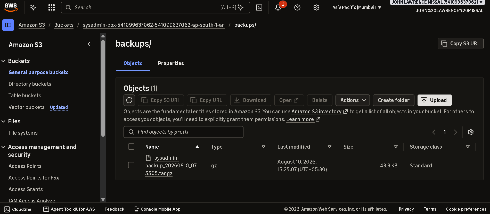

# Project 1 — SysAdmin Box

Automated Linux Server on AWS with Nginx, Log Cleanup, and S3 Backups.

This is my first hands-on DevOps project. The goal was to set up a real server, host a website on it, and automate the maintenance work that is usually forgotten — log cleanup and backups.

Status: Completed — Working live on AWS.

<table>
<tr>
<td width="50%" valign="top">

###


Website running live on Nginx.

</td>
<td width="50%" valign="top">

### 


S3 backup folder with .gz log file.

</td>
</tr>
</table>

<table>
<tr>
<td width="50%" valign="top">

### Server
**AWS EC2**
Amazon Linux 2023
Host everything

</td>
<td width="50%" valign="top">

### Web Server
**Nginx**
Serve website
Generate logs

</td>
</tr>
<tr>
<td width="50%" valign="top">

### Log Cleanup
**`scripts/log-cleanup.sh`**
Bash
Find >7 days, compress to `.gz`, delete >30 days

</td>
<td width="50%" valign="top">

### Cloud Backup
**`scripts/s3-backup.py`**
Python + boto3
Upload only `.gz` to S3 `backups/`

</td>
</tr>
<tr>
<td width="50%" valign="top">

### Automation
**Cron**
`0 2 * * *`
Daily at 2 AM

```bash
0 2 * * * /home/ec2-user/sysadmin-box/scripts/log-cleanup.sh
```

</td>
<td width="50%" valign="top">

### Security
**IAM Role**
`sysadmin-box-ec2-s3-role`
EC2 → S3 only
No keys in code

</td>
</tr>
</table>

### Flow

| Step | What Happens |
| :---: | :--- |
| 1 | User visits, Nginx serves, logs made |
| 2 | Cleanup compresses logs older than 7 days |
| 3 | Backup uploads `.gz` to S3 |
| 4 | Server stays clean, logs stay safe |

### Project Structure

```
sysadmin-box/
├── screenshots/
│   ├── website.png
│   └── s3.png
├── scripts/
│   ├── log-cleanup.sh
│   └── s3-backup.py
└── readme.md


### What I Learned

| | |
| :--- | :--- |
| 1 | Managing remote Linux via SSH / Instance Connect |
| 2 | Installing and configuring Nginx |
| 3 | Writing Bash scripts |
| 4 | Scheduling with Cron |
| 5 | Automating AWS with Python + boto3 |
| 6 | Securing EC2 → S3 with IAM |
| 7 | Git + GitHub |

> Most learning came from debugging — permissions, paths, IAM. Fixing those made it clear.

```
